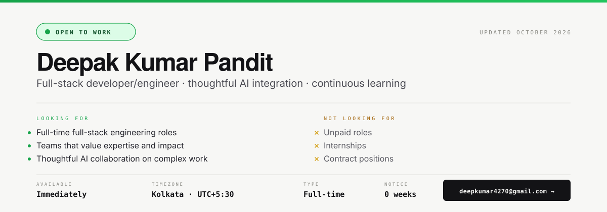

<h1 align="center">  </h1> 
     
 
  

  

🚀 Quick Overview

💻 Role: Software Engineer | Full-Stack Developer | React Developer

🔭 Currently Building: Scalable web and mobile applications

🌱 Currently Exploring: System Design, advanced React/React Native, distributed systems, and cloud technologies

🤝 Open to Collaborate: Open-source projects, developer tools, and scalable applications

🧠 Problem Solving: Passionate about Data Structures & Algorithms and building efficient solutions

💬 Ask Me About: React.js, React Native, C++, TypeScript, JavaScript, Kafka, and DSA

📂 Projects: github.com/deep4270

📫 Reach Me: deepkumar4270@gmail.com

💻 Tech Stack
🧠 Languages

        

🎨 Frontend

           

⚙️ Backend & APIs

      

🗄️ Databases & Storage

      

☁️ Cloud, DevOps & Tools

          

🤖 AI / Data & Other Technologies

      

---

🔗 Connect With Me

     

⚡ Fun Fact

I enjoy taking complex problems, breaking them down into simple pieces, and turning them into scalable solutions. 🚀

  

